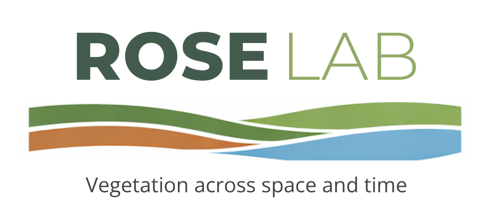
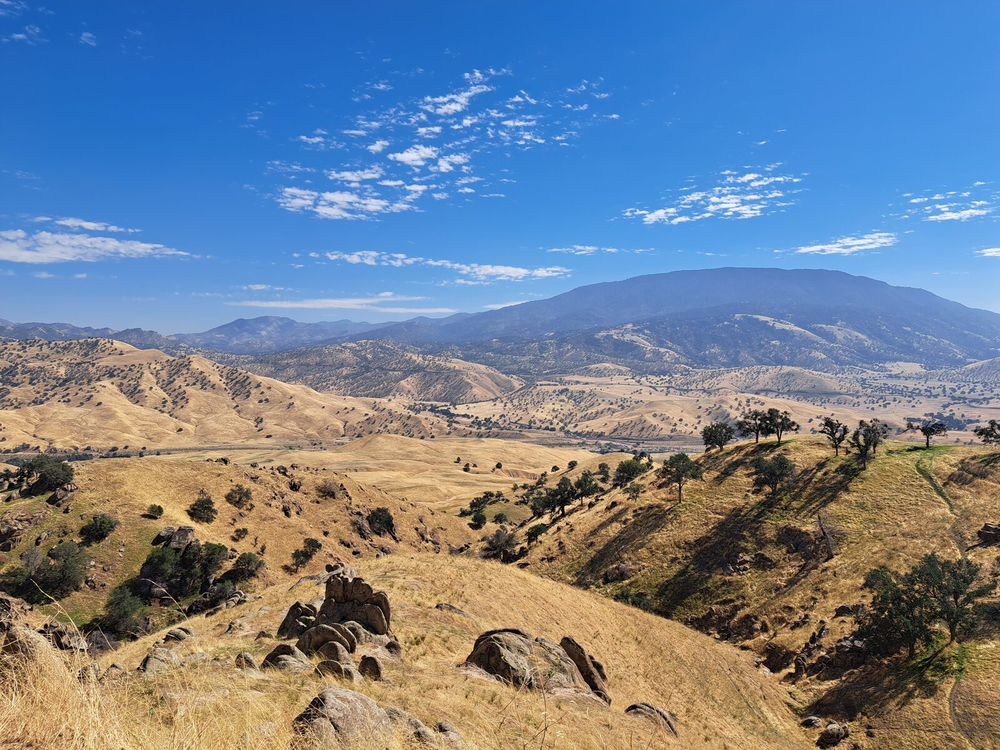
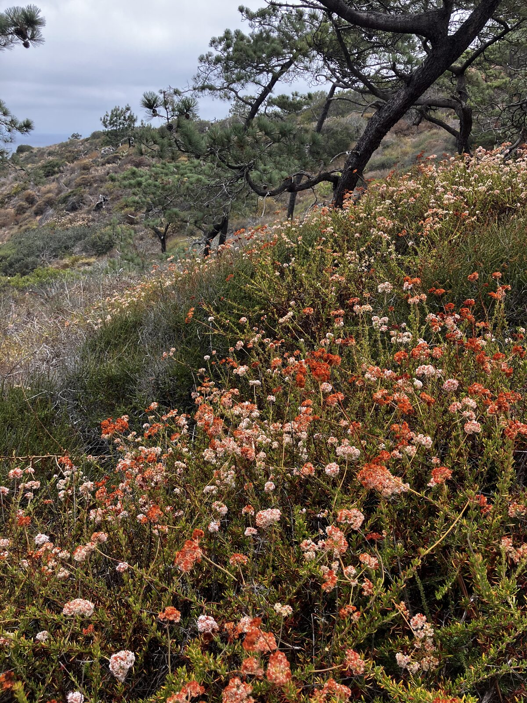
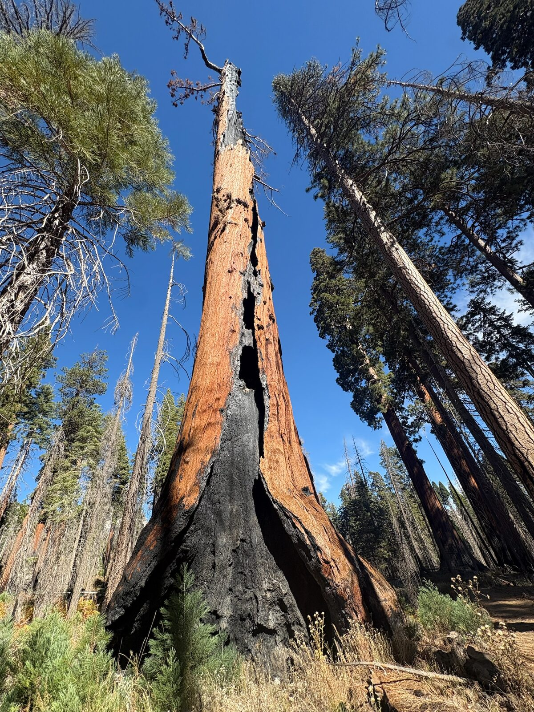
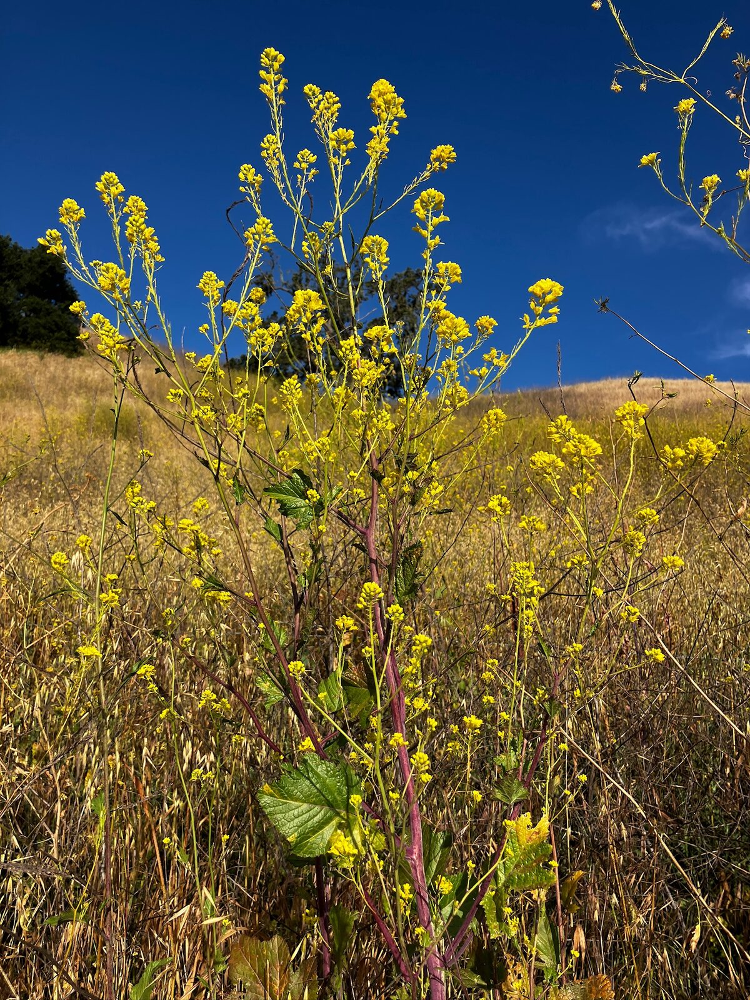
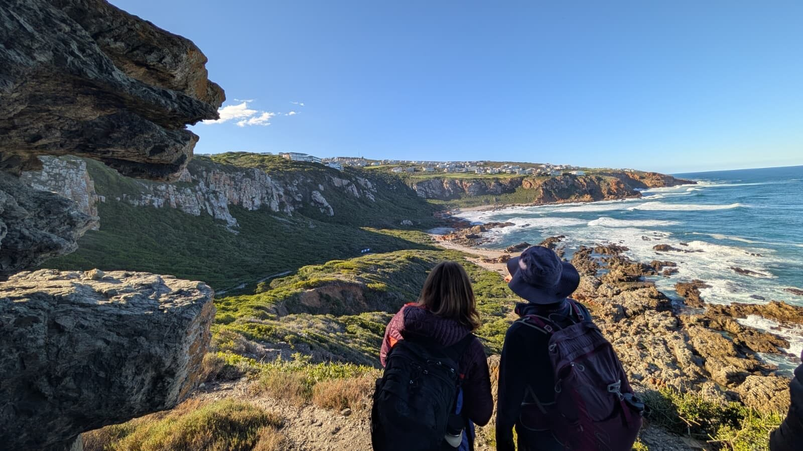
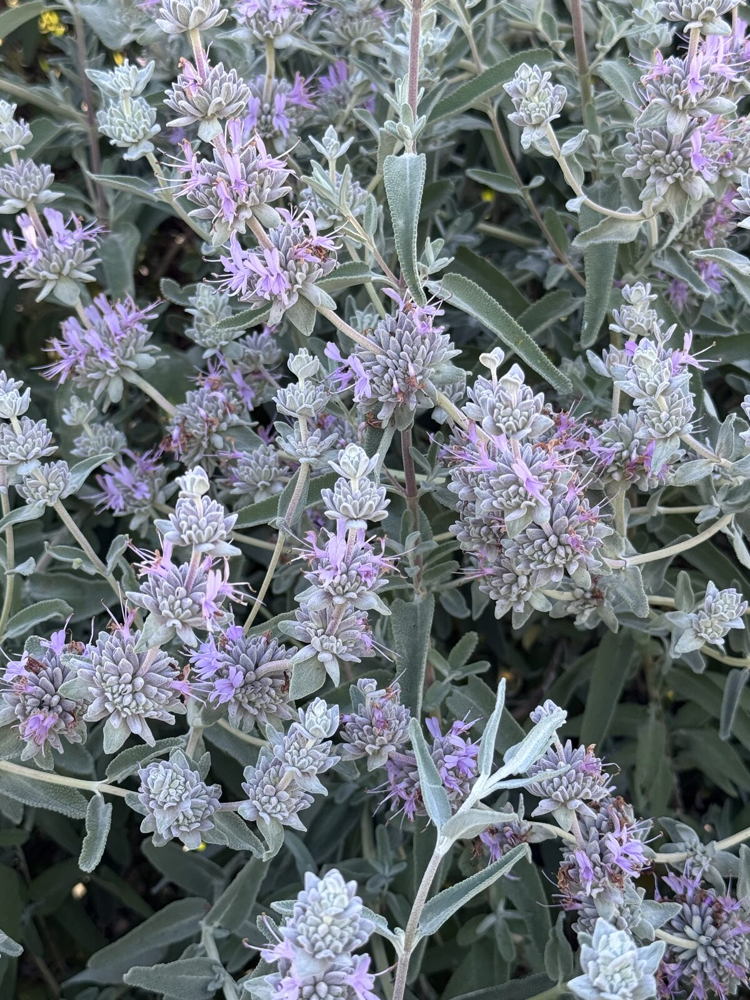
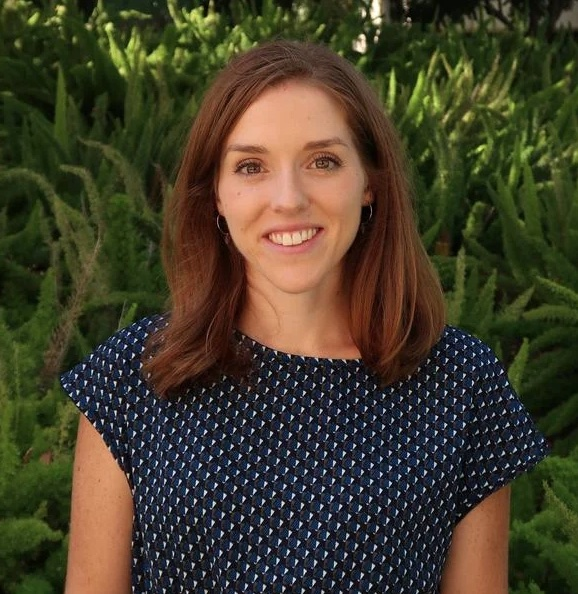

{fig-alt="Rose Lab logo: vegetation across space and time" width="100%"}

We study how vegetation changes across landscapes and through time by integrating remote sensing, field observations, and ecological models. Our work links processes across scales to understand and predict ecosystem dynamics in a changing world.

::: {.photo-grid}
{fig-alt="Oak savanna on golden hills under a blue sky" group="field"}
{fig-alt="Coastal hillside covered in orange and white wildflowers" group="field"}
{fig-alt="Fire-scarred giant sequoia among living trees" group="field"}
{fig-alt="Yellow-flowering mustard in dry grassland" group="field"}
{fig-alt="Researchers looking out over the rocky south coast of South Africa" group="field"}
{fig-alt="Close-up of lavender sage flowers" group="field"}
:::

------------------------------------------------------------------------

### About Me

I am a conservation biogeographer and landscape ecologist focused on understanding vegetation change across space and time and supporting decision-making under environmental change.

I collaborate with partners including The Nature Conservancy, the Climate Science Alliance, and ELMT Consulting to develop spatial products that inform restoration and climate-adaptive land management.

  

------------------------------------------------------------------------

### Education

- **Ph.D. in Plant Biology**, University of California, Riverside (2023)  
- **M.S. in Geography**, University of Tennessee, Knoxville (2019)  
- **B.S. in Environmental Science**, Rhodes College (2016)

------------------------------------------------------------------------

### Research Themes

- 🌼 Plant phenology and flowering dynamics  
- 🌳 Vegetation–climate relationships and forecasting  
- 🛰️ Remote sensing of ecosystem resilience
- 🌍 Deep-time vegetation reconstruction

------------------------------------------------------------------------

## Get in touch

📧 mbrose@sdsu.edu
📍 James Madison University (starting spring 2027)
